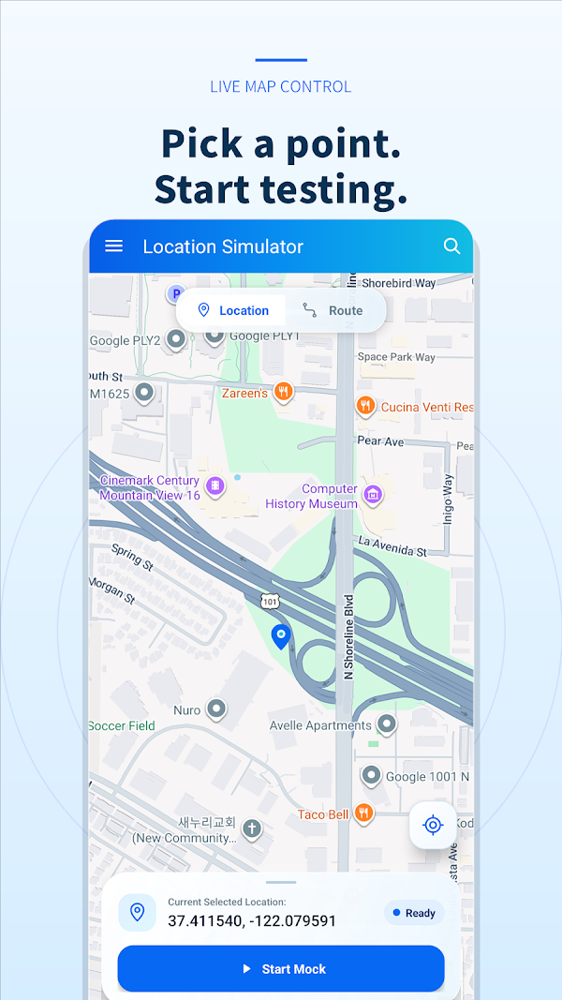
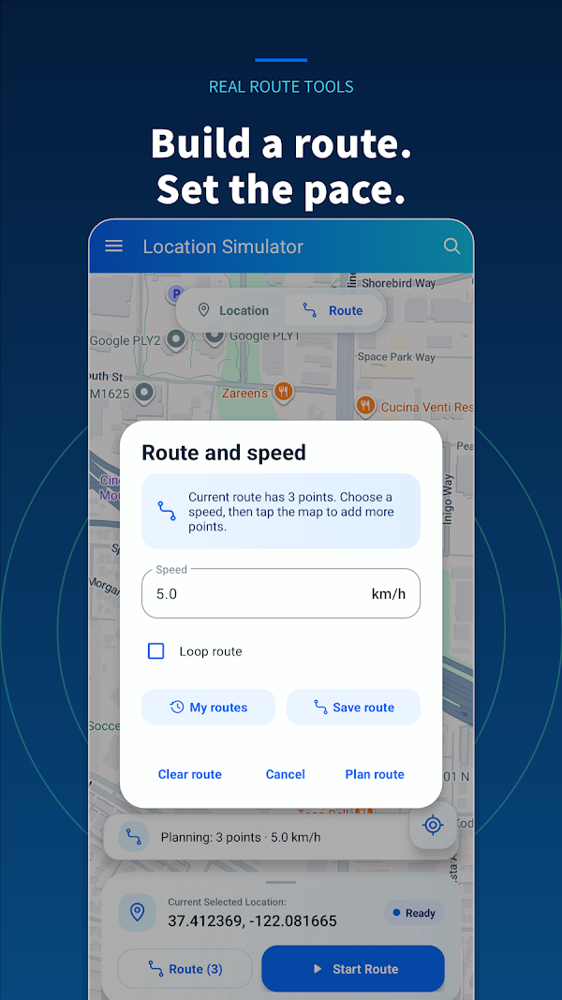

# Wukong Virtual Location - Инструмент Mock GPS для Android | 悟空虚拟定位

Wukong Virtual Location (Mock Location) предоставляет тестовые координаты через функцию фиктивного местоположения Android. Выберите точку на карте, найдите место, введите координаты или смоделируйте маршрут. Root не требуется.

**[⬇ Скачать APK](https://github.com/ChenGuoqing1001/MockLocation/releases/latest/download/MockLocation-google.apk)**

   
  

 

## Предпросмотр приложения

  
  

Другие языки

[中文](README.md) · [English](README_en.md) · [Español](README_es.md) · [Français](README_fr.md) · [Deutsch](README_de.md) · [日本語](README_ja.md) · [한국어](README_ko.md) · [Русский](README_ru.md) · [Português](README_pt.md) · [Português (BR)](README_pt_BR.md) · [Italiano](README_it.md) · [العربية](README_ar.md) · [हिन्दी](README_hi.md) · [Türkçe](README_tr.md) · [Nederlands](README_nl.md) · [Tiếng Việt](README_vi.md) · [ไทย](README_th.md) · [தமிழ்](README_ta.md) · [Bahasa Indonesia](README_id.md)

## Возможности

- Выбор точки на карте и поиск мест или адресов.
- Ввод и преобразование координат WGS84, GCJ-02 и BD-09.
- Моделирование маршрутов с путевыми точками и настройкой скорости.
- Переключение между доступными картами, включая Google, AMap и Baidu.
- Избранное и история для повторных тестов.

## Как настроить фиктивное местоположение в Android

1. Скачайте и установите APK. При необходимости разрешите установку используемому браузеру или файловому менеджеру.
2. В разделе «О телефоне» нажмите на номер сборки семь раз, чтобы включить параметры разработчика. Названия меню зависят от устройства.
3. В параметрах разработчика выберите это приложение для фиктивных местоположений.
4. Предоставьте разрешение на доступ к местоположению, выберите точку или введите координаты и запустите моделирование.
5. Обновите местоположение в тестируемом приложении и остановите моделирование после теста.

## Почему фиктивное местоположение не работает?

Проверьте выбранное приложение, разрешение на местоположение и состояние моделирования. После переустановки выберите приложение заново. Android помечает фиктивные местоположения; некоторые приложения могут обнаруживать или отклонять их.

## Xiaomi / HyperOS: остановка в фоновом режиме

Если моделирование прекращается после блокировки экрана или переключения приложений, проверьте ограничения батареи, фоновую работу и автозапуск, если такие настройки доступны. Разрешите фоновую работу для теста. Настройки зависят от версии системы.

## Поиск не работает или координаты смещены

Проверьте сеть и попробуйте другой источник карт при ошибках поиска или загрузки. При смещении позиции выберите систему, соответствующую введённым координатам: WGS84, GCJ-02 или BD-09.

## Конфиденциальность и использование

Избранное и история хранятся на устройстве. Карты и поиск используют сетевые сервисы; приложение не полностью автономное. Сведения о конфиденциальности и встроенных покупках доступны в Google Play. Используйте инструмент для разработки, тестирования и демонстраций, соблюдая правила тестируемых сервисов.

[Android](https://developer.android.com/studio/debug/dev-options) · [Google Play](https://play.google.com/store/apps/details?id=com.yangtools.gps.simulator)

## Загрузки и версии

- [Скачать APK](https://github.com/ChenGuoqing1001/MockLocation/releases/latest/download/MockLocation-google.apk)
- <a href="https://play.google.com/store/apps/details?id=com.yangtools.gps.simulator"> Google Play</a>
- [GitHub Releases](https://github.com/ChenGuoqing1001/MockLocation/releases)

Альтернативные загрузки

- [LanzouCloud](https://wwnr.lanzouv.com/b0knhjugb)
- [123Pan](https://www.123pan.com/s/k6bMjv-adiI.html)

## Сообщить о проблеме

Укажите версию приложения, модель устройства, версию Android и шаги воспроизведения: [GitHub Issues](https://github.com/ChenGuoqing1001/MockLocation/issues).
